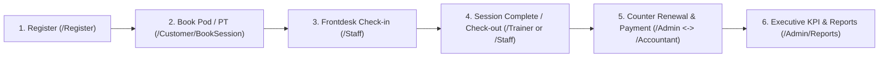
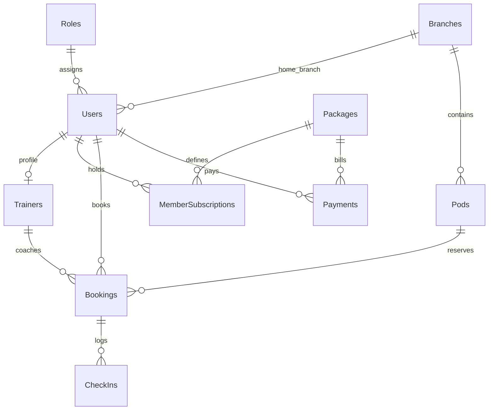

# PrivateGym — Private Fitness Pod & Multi-Role Club Management System

> Full-stack **ASP.NET Core MVC (.NET 10)** web application for managing a luxury private fitness pod club across **5 user roles** (`Customer`, `Staff`, `Trainer`, `Accountant`, `Admin`), backed by **MySQL** and **Entity Framework Core 9**.

---

## Table of Contents

1. [Tech Stack](#1-tech-stack)
2. [5-Role Architecture](#2-5-role-architecture)
3. [Core Business Flow](#3-core-business-flow)
4. [Database Schema (ER Diagram)](#4-database-schema-er-diagram)
5. [Key Business Logic & Security](#5-key-business-logic--security)
6. [Documentation Index](#6-documentation-index)
7. [Local Setup](#7-local-setup)

---

## 1. Tech Stack

- **Backend & Framework:** ASP.NET Core MVC (`.NET 10.0`, C#)
- **ORM & Database:** Entity Framework Core 9.0 (`Pomelo.EntityFrameworkCore.MySql`) + MySQL
- **Frontend:** Razor Views (`.cshtml`), Bootstrap 5, Vanilla JS, Unified `shadcn/ui Dark` CSS (`wwwroot/css/UnifiedWorkspace.css`)
- **Security:** `PasswordHasher<User>` (ASP.NET Core Identity), HTTP-only Session, Anti-Forgery Tokens (`[ValidateAntiForgeryToken]`)

---

## 2. 5-Role Architecture

| Role | Portal Route | Core Responsibilities |
| :--- | :--- | :--- |
| **Customer (Member)** | `/Customer` | Book Private Pods / 1-on-1 Trainers (conflict & maintenance checks), Cancel & refund quotas, Self Check-in/out, Package Top-ups & Scheduled Plan Rollover |
| **Staff (Operations)** | `/Staff` | Frontdesk Check-in/Check-out, Daily Pod & Trainer Schedule Matrix, Pod Maintenance & Slot Locking, Shift Handover Log synced to Admin |
| **Trainer (Coach)** | `/Trainer` | Weekly Teaching Schedule, Weekly Availability & Date Overrides, Client Workout Logs, Session Completion, Live Payout Tracking & CSV Export |
| **Accountant (Finance)** | `/Accountant` | Revenue Analytics, Pending Payment Approval (`RENEW-` / `NEXT-` auto-activation), VAT 7% Tax Invoices, Subscription Lifecycle Tracking |
| **Admin (Management)** | `/Admin` | Executive KPI Dashboard, Member Directory (Real Pagination + Counter POS Renewal Modal + Audited Manual Quota Adjustment), Staff/Trainer/Package/Pod Management, Weekly/Daily Master Schedule, Booking Inspection Desk, Transaction Audit Console, Hourly Demand Heatmap |

---

## 3. Core Business Flow



---

## 4. Database Schema (ER Diagram)



---

## 5. Key Business Logic & Security

- **Counter POS Renewal & Audit Trail:** Renewals at the Admin desk require payment method & slip/EDC reference (for non-cash), record `Payments` (`Success` or `Pending`), block duplicate `Pending` bills, and auto-credit quotas only after payment approval.
- **Rollover vs Reset:** Renewing before `EndDate` extends the expiry date and rolls over remaining quotas; renewing after expiry starts a fresh cycle from today.
- **Cross-Role Integrity Guards:**
  - `Maintenance` Pods immediately block new bookings in Customer Portal and manual check-ins in Admin/Staff.
  - `Suspended` / `Inactive` accounts are blocked from logging in, booking sessions, or manual check-in.
  - Checked-in bookings cannot be cancelled for quota refunds.
- **Confirmation Modals:** Critical state-changing & financial actions are guarded by `#pgConfirmModal`.

---

## 6. Documentation Index

| Document | Purpose |
| :--- | :--- |
| [`docs/SYSTEM_DESIGN.md`](./docs/SYSTEM_DESIGN.md) | System Architecture, Cross-Role Flows, Business Logic Guards & Controller Map |
| [`docs/DESIGN_SYSTEM.md`](./docs/DESIGN_SYSTEM.md) | `shadcn/ui Dark` Design Tokens, Unified Sidebar & Shared Component Standards |
| [`MASTER_TEST_CASES.md`](./MASTER_TEST_CASES.md) | Full-System QA & E2E Test Plan + Verified Browser Test Results (Suites 0–8) |

---

## 7. Local Setup

1. Ensure **MySQL** is running and database `CSI402DB` is imported.
2. Copy `appsettings.example.json` to `appsettings.json` and set your `ConnectionStrings:DefaultConnection`.
3. Build and run:
   ```bash
   dotnet build
   dotnet run --urls http://localhost:5180
   ```
4. Open `http://localhost:5180` in your browser.
